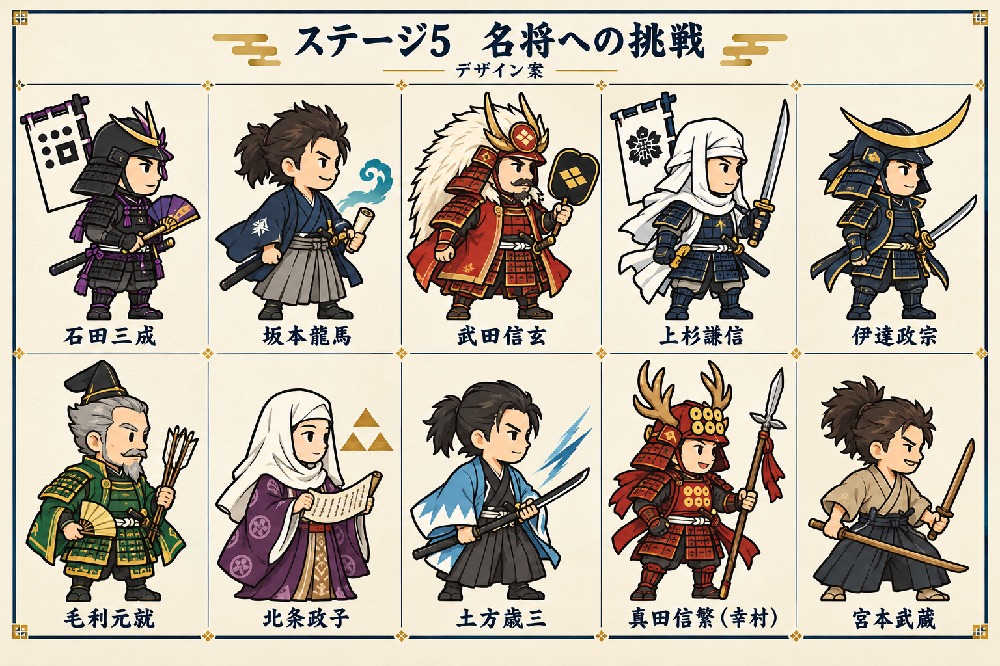

# ステージ5「名将への挑戦」人物・デザイン案

作成日: 2026-10-22。先生の「まずは人物とデザインを考えて」への初案。
その後「ゲームの実装もやってみて」の指示により実装済み。現在の動作・数値・検証は [実装メモ](IMPLEMENTATION.md) を参照。以下は当初の検討案を残したもの。

## ねらい

このゲームの既存の味方42人に入っていない、有名な実在人物と戦う。初めて勝つと、その人物が確実に仲間になる。敵として苦戦した得意技を、自分でも使える楽しさを中心にする。

「最強」はこのゲームでのボスとしての演出・性能を指す。史実の武力順位ではない。各時代の人物が出会う「時代をこえた挑戦」という設定にし、架空の対戦を実際の歴史上の戦いとして紹介しない。

既存の4はおかね・ひっさつのやりくりが中心。5は人物別の予告つきの得意技と攻略法を中心にする。HPや攻撃力だけを増やす形にしない。

## 既存データとの照合

- chars-data.js の REKISHI_CHARS 42人と照合する対象は下記10人。全国の小学校教材すべてで扱われないという意味ではない。
- 石田三成は st11 の既存ボス。味方42人にはいない。黒い鎧・白い旗の既存シルエットを引き継ぎ、5では「仲間にできる特別な三成」として紫の組紐・軍配などを追加する。
- 坂本龍馬は既存人物の説明に登場するが、味方カードとしては未登場。
- 42人の基本図鑑・学習問題を維持し、追加人物は「挑戦で出会った人物」の枠にまとめる案。追加人物の獲得を既存エンディングの新条件にはしない。

## 主力候補10人

下表の並びはデザイン画の左上→右上、左下→右下。対戦順ではない。
外見の配色、光、バリア、戦闘効果はゲーム用の創作案。技名は人物に関連する言葉を使い、実際に超能力があったかのような説明にしない。

| 人物・読み | 採用理由・覚える内容 | 外見の方向性 | 敵としての得意技と攻略の入口 | 仲間になったとき |
| --- | --- | --- | --- | --- |
| 石田三成／いしだみつなり | 関ヶ原の戦いで西軍の中心となった人物。既存ボスから仲間になる喜びを作れる | 黒い鎧＋紫の組紐。白い旗・軍配。整った姿勢の知将 | 西軍の采配：旗を掲げてから周りの兵を強化。旗の効果が切れる時間に攻める | 後列から近くの仲間を一時強化する、采配型 |
| 坂本龍馬／さかもとりょうま | 薩長同盟の成立に尽力。既存の西郷隆盛・木戸孝允・勝海舟とつながる | 紺の着物・灰色の袴・ブーツ・結った髪。手紙と波の意匠 | 薩長同盟：二つの援軍隊を時差で呼ぶ。援軍の合流前に対処する | 近くの仲間同士をつなぎ、出撃や連携を助ける支援型 |
| 武田信玄／たけだしんげん | 戦国を代表する大名。「風林火山」と結び付けやすい | 朱色の重い鎧・白い毛の兜・大きな軍配。どっしりした輪郭 | 風林火山：加速・守備・攻撃・不動の構えを予告して切り替える。守る時と攻める時を見分ける | 費用は高いが、前線を維持できる重装型 |
| 上杉謙信／うえすぎけんしん | 信玄と対になる戦国の名将。「毘」の軍旗が印象的 | 白い頭巾・紺の鎧・刀・白い軍旗。信玄の赤と対比 | 毘の旗：構えの後、短時間の強烈な迎撃。構え中は新しい出撃をため、終了後に攻める | 短い射程で素早く迎え撃つ、迎撃型 |
| 伊達政宗／だてまさむね | 仙台藩の初代藩主。三日月の兜で見分けやすい | 紺黒の鎧・大きな金の三日月前立。配色は黒と金 | 三日月の突撃：地面の進路表示の後に前方へ突進。予告を見て前衛を準備する | 移動が速く、前線を押し上げる突破型 |
| 毛利元就／もうりもとなり | 中国地方で勢力を広げた大名。結束を説く「三子教訓状」とつながる | 深緑＋金の鎧、白髪と短いひげ。三本の矢・扇 | 三矢の結束：三隊がそろうと互いを守る。まず一隊を崩す | 数人の仲間をまとめて守る、結束型 |
| 北条政子／ほうじょうまさこ | 鎌倉幕府を支えた「尼将軍」。武器以外で強さを表せる | 白い尼頭巾・深い紫の衣・巻物。落ち着いた女性の姿 | 御家人の結束：予告の後、兵の守備を立て直す。連続攻撃で支援の間を崩す | 仲間の守備と立て直しを助ける支援型。既存の回復枠を使う場合も説明は「結束」とする |
| 土方歳三／ひじかたとしぞう | 新選組の副長。幕末の異なる立場の人物に出会える | 浅葱色のだんだら羽織・黒い袴・刀。京都時代の記号で統一 | 新選組の連撃：合図の後に連続斬り。連撃後の休みが攻めどき | 低めの一撃を素早く重ねる、連撃型 |
| 真田信繁（幸村）／さなだのぶしげ（ゆきむら） | 大坂の陣で活躍。最後の名将にふさわしい華やかさ | 赤い鎧・六文銭・鹿角の兜・十文字槍。広く親しまれる武将像を使った意匠 | 真田丸：防御の構え→突撃の二段階。守りを崩してから突撃に備える | 前衛の守りと突撃を切り替える、終盤の主力 |
| 宮本武蔵／みやもとむさし | 二天一流の剣豪。軍勢ではなく一人の強さで最終試練を作れる | 生成りの着物・濃い袴・無造作な髪。大小二本の木刀。鎧を着けない | 二天一流：短い構えから二連撃。構え中の受け流し後に隙を作る。常時無敵にはしない | 単体への攻撃に優れた剣豪。高い出撃費用や再出撃間隔で使いどころを作る |

## 戦いの構成案

まずは「10人・10試練」を提案する。既存の17面をそのまま複製するかは未決定。

入口は三成・龍馬など、仲間になる喜びが分かりやすい人物。信玄・謙信は対になる連続試練にする。終盤の大きな山を信繁にし、ほか9人に勝つと武蔵との最終試練が開く形を候補にする。

全員に少なくとも一つ「見て分かる予告」と「攻められる隙」を用意する。攻略のヒントは短いひらがなの文と図で出す。新しい人物を使わない編成でも攻略できる余地を残す。

## 勝利と仲間入りのデザイン

- 初勝利で、その相手が確実に使えるようになる。低確率ドロップにはしない。
- 勝利時は相手が一礼し、「きみの ちから、みせてもらった！」「これからは なかまだ！」と表示。名前にふりがなを付ける。
- 敵と仲間で顔・服・持ち物は同じ。敵時は大きめの表示と背後の演出、仲間時は通常の大きさにし、強かった相手を使っている実感を保つ。
- 初回獲得時に、史実に基づく短い人物紹介を1〜2文出す。架空の対戦や技の効果は学習クイズの正解文に混ぜない。
- 特別カードの目印は紺と白金の枠＋小さな「挑戦の証」。4で獲得する金色の背景は、そのまま意味を保つ。
- 仲間の能力はボスの技の特徴を引き継ぐが、ボスのHP・攻撃倍率をそのまま使わない。既存の42人と組み合わせて強くなる調整にする。
- 初期レベル・育成・必要な出撃費用・性能値は未決定。次の試練で使ってみられる入り口を用意する。

## 絵の共通ルールと今回の画像の扱い

- 既存と同じ2.5頭身・太い輪郭・明るいデフォルメ。色だけでなく、兜・頭巾・服・持ち物でも見分ける。
- 実在人物は堂々とした相手役。人間に鬼の角・牙などを付けない。信繁の鹿角は兜の飾りとして描く。
- 今回の画像はデザイン検討用の集合画。生成時の装飾・旗の模様は史料の正確な再現ではない。
- 本制作では三成の旗印などを別途整え、表示時の左右反転で文字が鏡文字にならないようにする。小さな戦闘絵では文字を省き、カード側に正しい旗印を載せる案。
- 信繁の赤い鎧・鹿角・十文字槍などは親しまれている象徴的な武将像で、本人の装備の厳密な復元とは区別する。
- 政宗の眼帯は本人が着用した確実な史実として教えない。今回の識別点は三日月の兜に置く。
- 毛利の「三本の矢」は伝承。学習文では「三子教訓状で息子たちに結束を説いた」を軸にする。
- 幸村は広く知られる呼び名。カード・図鑑で「信繁（幸村）」と併記する。
- 土方の浅葱色の羽織は新選組を表す記号として採用した案。本人の日常着や箱館時代の服装の復元として扱わない。
- 本番スプライトは別制作。既存仕様どおり、素材は右向き・立ち／歩き／技／やられの4ポーズ、透明背景。敵表示だけゲームで反転する。
- 仲間の顔が48px程度でも見分けられるか、右向きの4ポーズがそろうかを制作時に確認する。

## 参照資料

歴史的な名前・モチーフと、ゲーム用の創作を区別するための調査。画像を転載せず、既存ゲームの絵をスタイル参考にして新規生成した。

- [高知県立坂本龍馬記念館・常設展示](https://ryoma-kinenkan.jp/collection/exhibition.html)：薩長同盟の裏書、龍馬に関連する資料。
- [江戸東京博物館・龍馬伝](https://www.edo-tokyo-museum.or.jp/s-exhibition/ryomaden/)：勝海舟、亀山社中、薩長同盟、海援隊とのつながり。
- [仙台市博物館・武器・武具](https://www.city.sendai.jp/museum/shuzohin/shuzohin/shuzohin-05.html)：政宗の黒漆五枚胴具足と金色の月形前立。
- [新城市・長篠城址史跡保存館展示解説](https://www.city.shinshiro.lg.jp/mokuteki/shisetu/shiryokan/nagashinojyoshi/tenjikaisetsu.html)：信玄と風林火山。
- [国立歴史民俗博物館 khirin・軍旗 毘の字](https://khirin.rekihaku.ac.jp/pid/nmjh_rekimin_h/10647084.html)：上杉軍の軍旗の記録。
- [国立国会図書館レファレンス協同データベース・三成の旗印](https://crd.ndl.go.jp/reference/entry/reference/show?id=1000072050&page=ref_view)：旗印の表記と参考文献。
- [安芸高田市・三矢の訓の史実性と三子教訓状](https://www.akitakata.jp/ja/shisei/section/soumu_soumu2/z275/koramu22/p936/)：矢を折る逸話の真偽は不明で、結束を説く書状がある。
- [鎌倉市・北条政子の生涯](https://www.city.kamakura.kanagawa.jp/kouhou/kamakura/21/t211101-6.html)：尼将軍と御家人の結束。
- [土方歳三資料館](https://www.hijikata-toshizo.jp/)・[日野市・和泉守兼定](https://www.city.hino.lg.jp/shisei/keywords/1014655/1014763.html)：新選組副長と関連資料。
- [上田市立博物館・真田信繁（幸村）](https://museum.umic.jp/hakubutsukan/ueda-castle-history/03/)：実名は信繁、大坂の陣での活動。
- [上田市立美術館・真田丸展の資料](https://www.santomyuze.com/museumevent/sanadamaru/sanadamaru_midokoro/)：六連銭などのモチーフ。
- [熊本市観光ガイド・武蔵塚公園](https://kumamoto-guide.jp/spots/detail/56)・[熊本城公式・歴史](https://castle.kumamoto-guide.jp/history/)：宮本武蔵、二天一流と五輪書。

## ファイル

- character-lineup-v1.png：組み合わせを比較するための初回デザイン集合画。
- image-prompt-v1.txt：内蔵 image_gen に渡した最終プロンプト。既存の三成・信長・西郷の立ち絵3枚をスタイル参考に指定。
- 本書は初回検討時の資料。以後の実装状況・本番画像・保存の扱いは IMPLEMENTATION.md を参照。
